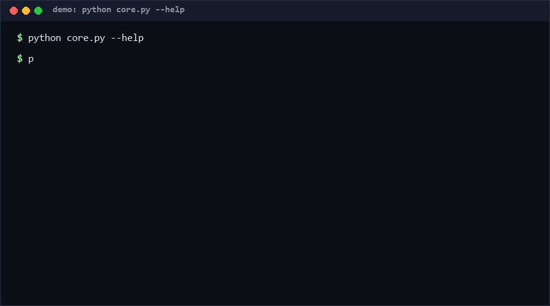

# quota-aware-scheduler

A quota-aware scheduling core for code that talks to several rate-limited
sources: keep a per-source sliding-window usage ledger over virtual time,
ask `decide()` which source admits the next job, and `plan()` a whole job
list deterministically. Single-process simulation — no network, no threads,
no wall clock. Confidence: high for the ledger and decision math (unit-tested,
~50 cases); medium for wait predictions under bursty traffic.

as of 2026-10-11

<p align="center"></p>

## Problem

Code that fans out to multiple rate-limited APIs usually hard-codes
`sleep()` guesses. That wastes headroom on quiet sources, violates limits on
busy ones, and is untestable because real clocks are involved. What is
missing is a small, deterministic decision layer you can unit-test: given
per-source limits and windows, which source admits the next unit of work,
and if none does, exactly when will one?

## How it works

- `QuotaLedger` records `(timestamp, cost)` events per source and computes
  usage in the half-open window `(t - window_s, t]`. `available()` is
  `limit - used`.
- `decide(ledger, t, cost)` picks the candidate with the most headroom that
  can admit now (ties broken by candidate order → deterministic). If none
  fits, it computes the earliest virtual time where a window drains enough
  and returns that as `wait_s`.
- `plan()` walks a job list sequentially, records admissions, and advances
  virtual time — producing a replayable schedule.
- Exit codes: `0` ok, `2` bad input (CLI).

## Quickstart

```bash
python core.py spec.json      # spec: sources + jobs (see README) (~1 s)
python self_test.py           # ~50 test cases (~4 s)
```

Example `spec.json`:

```json
{"sources": {"api-a": {"limit": 5, "window_s": 60}},
 "jobs": [1, 1, 1, 2], "t0": 0.0}
```

## Why not X

| Alternative | Stars (as of 2026-10-11) | How this differs |
| --- | --- | --- |
| [rstrobl/rate_limited_scheduler](https://github.com/rstrobl/rate_limited_scheduler) | 4 | Redis-based limiter for live, time-critical API access; this repo is an offline, dependency-free decision core with virtual time that you can unit-test and then port. |
| [ase-sketch/dsh-agent-swarm](https://github.com/ase-sketch/dsh-agent-swarm) | 6 | A plugin bundling batch subagent swarms with adaptive rate-limit scheduling; this repo isolates only the quota-accounting + decision interface as a reusable library. |
| [putflix/rate-limit-scheduler](https://github.com/putflix/rate-limit-scheduler) | 0 | Maintains an HTTP request queue for rate-limited services at scale; this repo has no I/O layer at all — decisions only, so it composes with any transport. |

Anchors found via search as of 2026-10-11; descriptions paraphrased.

## Minimal Fallback

Without this library: a per-source counter plus `time.sleep(60 - elapsed)`
after each call. It works for a single source and single process, but it
cannot answer "which of my 5 sources should take this job" or be tested
without waiting real seconds.

## Design Trade-offs

- Virtual time over real time: fully deterministic and testable, but you
  must integrate the clock yourself in production code.
- Sequential `plan()` only: no priorities, deadlines, or preemption — a
  decision layer, not an OS scheduler.
- Exact sliding-window accounting (event list, not buckets): precise waits,
  O(n) per query over windowed events; fine for thousands of events, not
  millions.

## Limits & Second-order Effects

- The ledger trusts recorded costs; a lying caller corrupts the schedule.
- Wait predictions assume no one else consumes the source — in shared
  environments re-decide before firing.
- Second-order effect: because `decide()` prefers max headroom, quiet
  sources get drained first; if you need source-affinity, pass an explicit
  candidate `order`.

## FAQ

**Does it touch the network?**
No. It is a pure computation over data structures you feed it. Red line by
design: single-process simulation only.

**When NOT to use this?**
Distributed multi-process quota enforcement (this has no shared-state
story), token-bucket-style burst semantics (this is strict sliding window),
or when you need weighted fairness — the tie-break is order, not weight.

**Why sliding window instead of fixed windows?**
Fixed windows allow 2x bursts at boundaries. Sliding windows trade memory
for exactness.

## Core Assumptions

- [A1] Costs are positive integers known before dispatch.
- [A2] One process owns the ledger; concurrent writers are out of scope.
- [A3] Source limits/windows are static during a `plan()` run.

Confidence: decision math high (property-tested for determinism); wait
predictions high for recorded events, medium for adversarial timing. All
claims as of 2026-10-11.

---

Part of the [zhengming-toolbox](https://github.com/chenhz01/zhengming-toolbox) — 55 purpose-built AI-engineering tools across neglected niches.

Related tools: [meeting-notes-to-tasks](https://github.com/chenhz01/meeting-notes-to-tasks) · [email-triage-spec](https://github.com/chenhz01/email-triage-spec) · [focus-data-aggregator](https://github.com/chenhz01/focus-data-aggregator)
